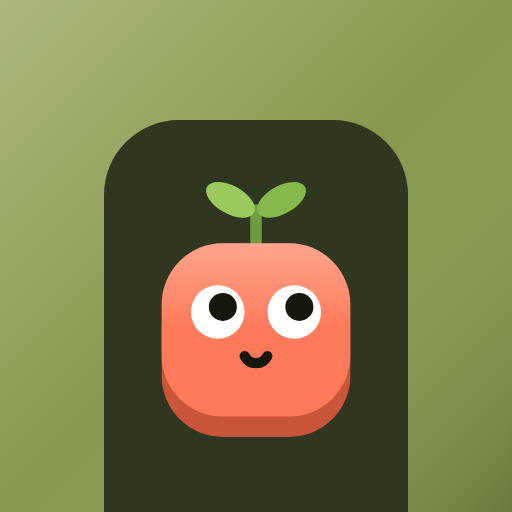
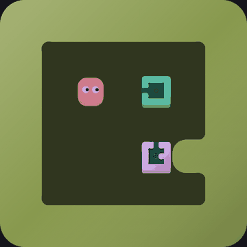
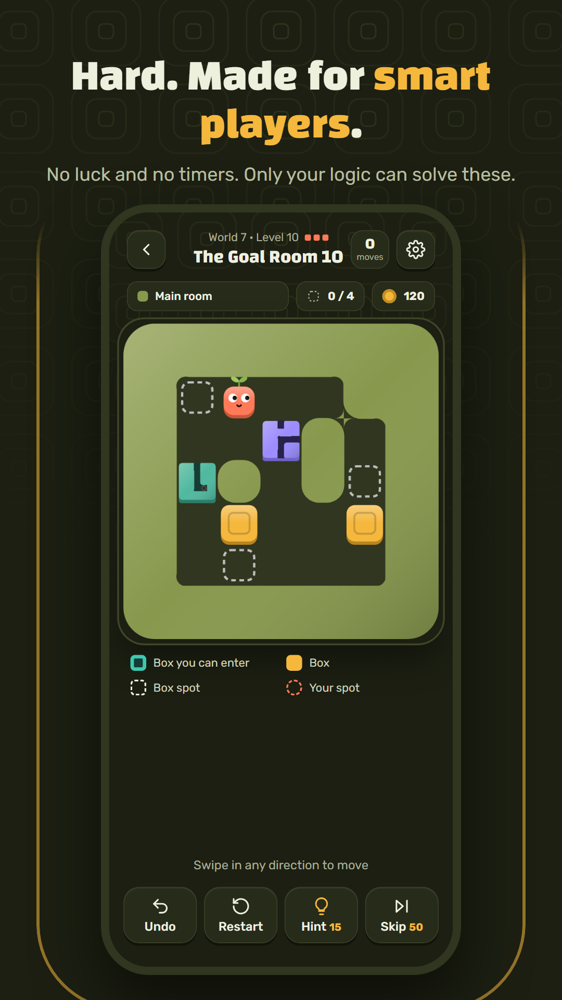
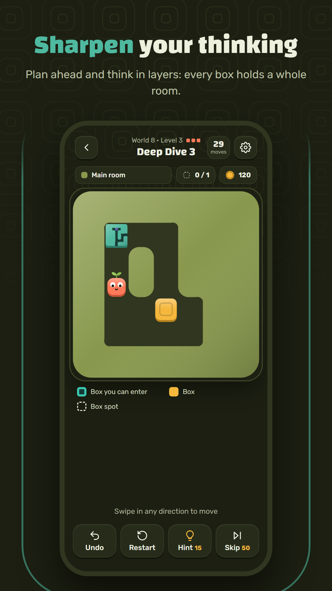
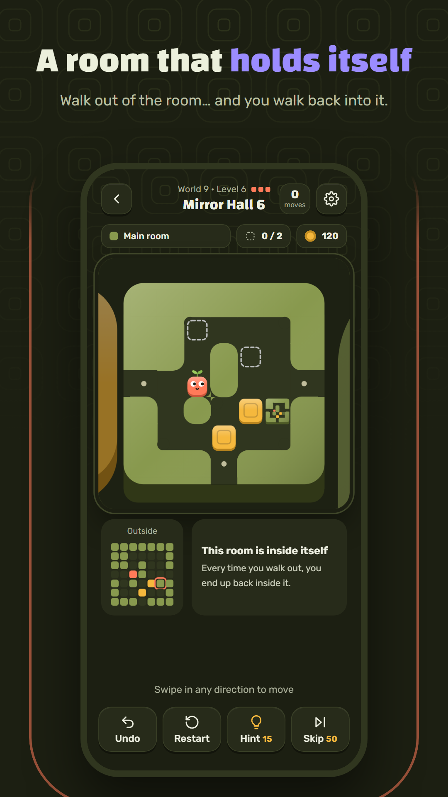
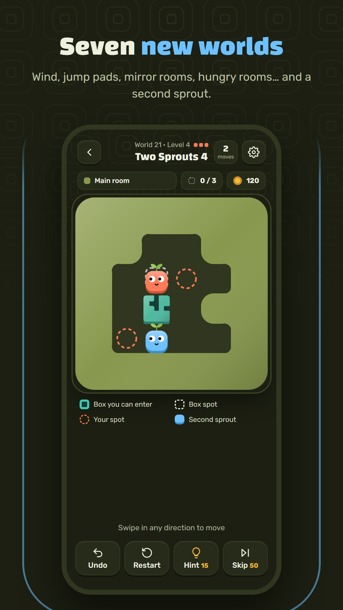
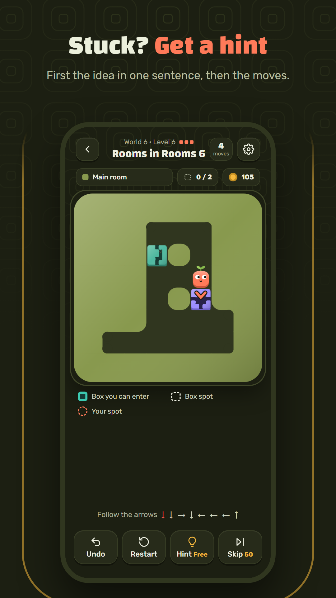
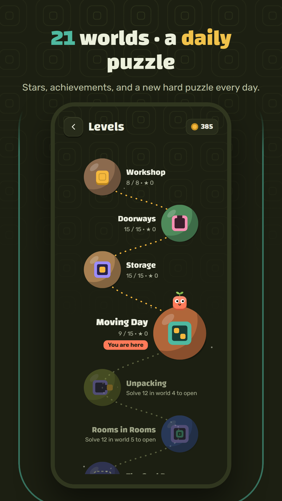
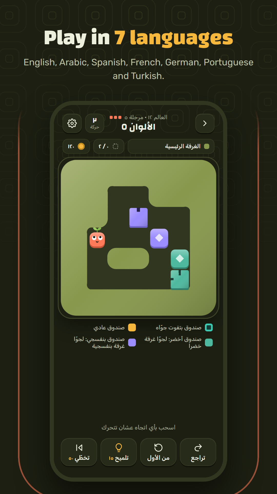

<p align="center">
  
</p>

<h1 align="center">Cubes Paradox</h1>

<p align="center">
  A puzzle game about boxes that hold whole rooms.<br>
  Push boxes, walk inside them, and find your way back out.<br>
  <b>193 levels · 14 worlds · a daily puzzle · 7 languages · fully offline</b>
</p>

<p align="center">
  <a href="https://rookieenough.github.io/Orion-Data/app/?id=cubes-paradox"></a>
  &nbsp;
  <a href="https://github.com/DAOUDsys/cubes-paradox/releases/latest"><b>or download the APK</b></a>
  <br>
  <a href="https://github.com/DAOUDsys/cubes-paradox/releases"></a>
</p>

<p align="center">
  
</p>

## Screenshots

<p align="center">
  
  
  
  
</p>
<p align="center">
  
  
  
</p>

## The game

Every colored box is a complete room. Push it like any box — or, when it can't move, walk right into it. Inside, the room is just as real: push boxes around, walk out through a gap in the wall, and you're back where you were. Boxes can go into rooms, rooms can go into rooms, and a few rooms even contain themselves.

Every world after the first is built around rooms inside rooms, often two or three levels deep, and each one has its own idea:

| # | World | Idea | Difficulty |
|---|---|---|---|
| 1 | Workshop | Push boxes onto their spots | Easy |
| 2 | Doorways | A colored box is a door: push it, or walk right in | Medium |
| 3 | Storage | Park a box inside a room, then take it back out | Hard |
| 4 | Moving Day | Pack boxes into a room, then move the whole room | Hard |
| 5 | Unpacking | Get boxes out of rooms; walking out pushes what is outside | Hard |
| 6 | Rooms in Rooms | A room inside a room, two levels deep | Hard |
| 7 | The Goal Room | The room itself must reach the goal, with you inside | Hard |
| 8 | Deep Dive | Three rooms down and back up | Hard |
| 9 | Mirror Hall | A room that holds itself | Hard |
| 10 | Holes | Fill a hole with a box to walk across | Hard |
| 11 | Cracked Floor | Floor breaks after you step off: one clean path | Hard |
| 12 | Colors | Each colored box belongs in the room of its color | Hard |
| 13 | Control Room | A plate inside one room opens a gate in another | Hard |
| 14 | One-Way Doors | Arrows on room doors: in one way, out another | Hard |

A world is a ladder. Its first level shows the idea, and each level after it asks for more than the one before: harder to work out, and using the idea at least as much. The last three levels of each world are optional challenges, the hardest of its idea. A new hard **daily puzzle** waits every day.

**Hard means hard to work out, not long.** A level's difficulty is measured by the choices on the way to its solution: how many real options there are at each one, how many of them quietly lose the level, and how often you have to leave one thing to move another or push something back. Steps do not count, so a long walk down a corridor is not a hard level. Every hard level has a single solution and several places where the wrong choice is a trap. In the game, one to three squares beside the level number show how hard it is.

## Features

- Every level checked by a solver: every one can be solved, every box in it is needed, and its shortest solution really uses its world's idea
- Stars for solving in the fewest moves, 12 achievements, and a daily puzzle with a streak
- Share a win from the win screen
- Two-step hints: first the idea in one sentence, then your next moves — from wherever you are
- Unlimited undo (or double-tap the board) and instant restart; come back to a level right where you left it
- Sound effects made on the fly, vibration on Android
- Swipe controls, plus arrow keys / WASD in a browser
- 7 languages: English, Arabic (full right-to-left layout), Spanish, French, German, Portuguese and Turkish
- The APK here and on Orion Store has all 14 worlds open. On Google Play the first 6 worlds are free and one purchase unlocks the other 8
- No ads, no accounts, no data collected — progress stays on the device ([privacy policy](https://daoudsys.github.io/cubes-paradox-privacy/))

## Run it

In a browser:

```
npm run serve
```

Then open http://localhost:8080 (arrows or WASD to move, Z undo, R restart, H hint).

Build the Android APK (needs Node, the Android SDK and Java 21):

```
npm install
npm run apk
```

The APK is written to `android/app/build/outputs/apk/play/debug/app-play-debug.apk`.

The app has two builds: `play` (Google Play, worlds 7–14 are one purchase) and `orion` (Orion Store and GitHub releases, every world open). Its `src/orion` folder replaces `www/js/edition.js`. `npm run release` builds both, signed, when `android/keystore.properties` is present.

## Levels

Levels are generated, solved and picked by scripts in `tools/`:

- `npm run gen` — generates candidate levels for 5 minutes into `tools/out2/`
- `npm run harden` — makes pool levels harder by small edits (open a wall, move a box, add a box), keeping only edits that add choices and traps
- `npm run curate` — picks each world's ladder and the daily puzzles, and writes `www/js/levels.js` and `www/js/daily.js`
- `npm run solve` — checks that every level can be won and that its stored solution (used by hints) works

## Project layout

| Path | What |
|---|---|
| `www/js/engine.js` | Game rules (no DOM), also used by the solver in Node |
| `www/js/render.js` | Canvas renderer, draws rooms inside rooms recursively |
| `www/js/planets.js` | The planets on the world map, the player and logo as SVG |
| `www/js/app.js` | Screens, input, animation, progress, hints |
| `www/js/i18n.js` | English and Arabic text, world names |
| `www/js/i18n-langs.js` | Spanish, French, German, Portuguese and Turkish |
| `www/js/levels.js`, `daily.js` | The 193 world levels and 90 daily puzzles |
| `tools/` | Level generator, hardener, picker and solver |
| `store/` | Store listing text, icon, banner and screenshots |
| `android/` | Capacitor Android project |

Built with plain JavaScript and [Capacitor](https://capacitorjs.com).
