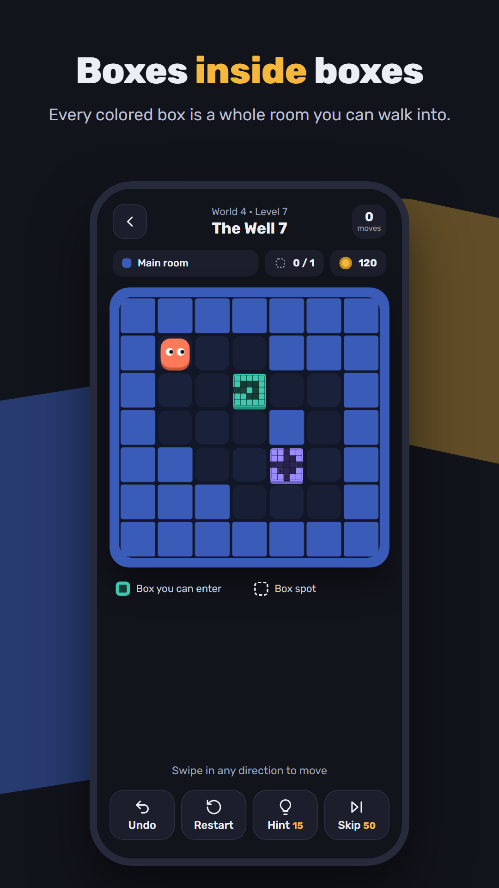
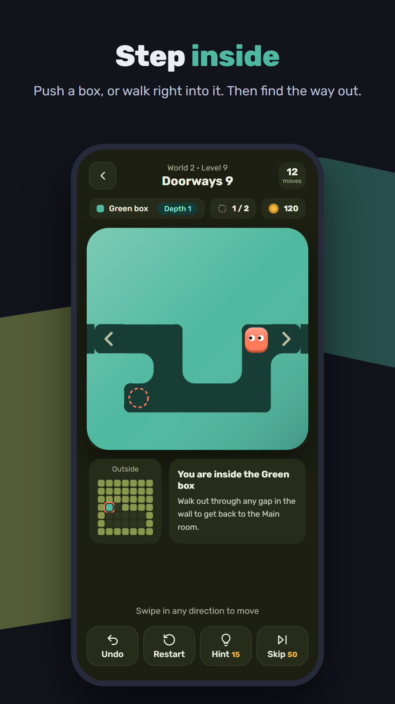
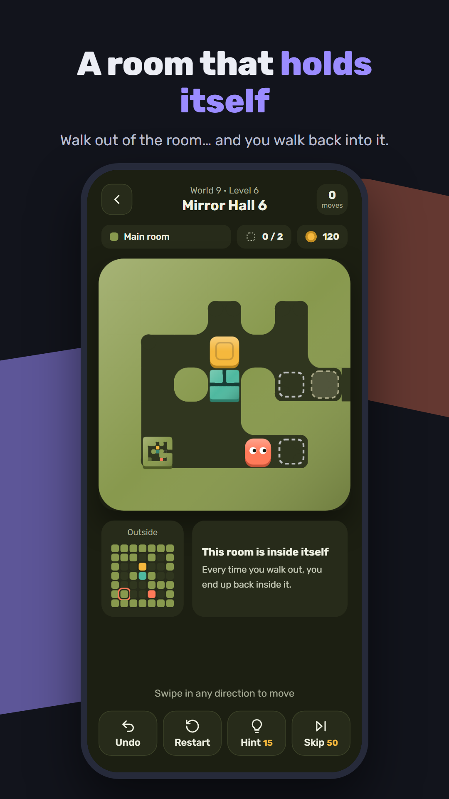
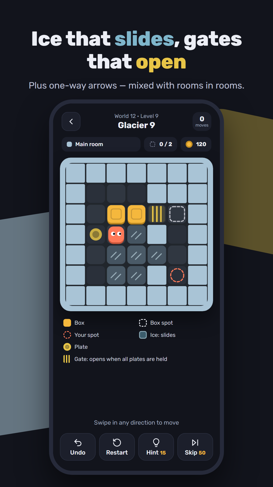
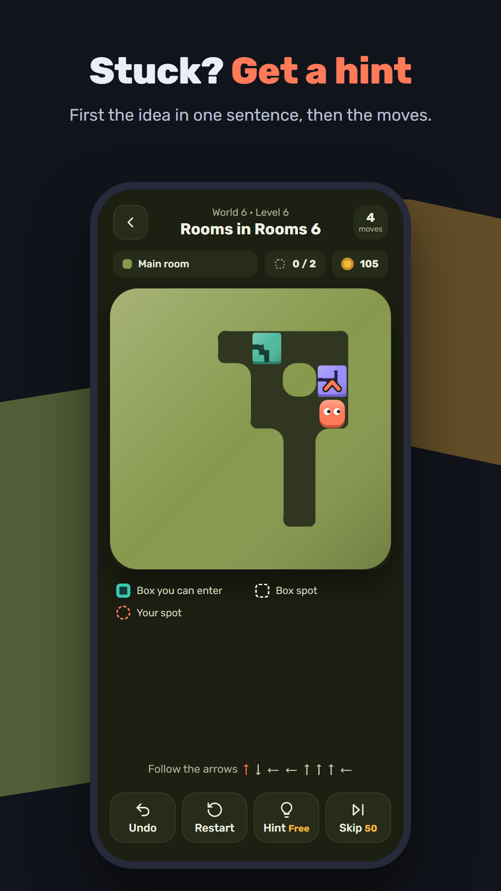
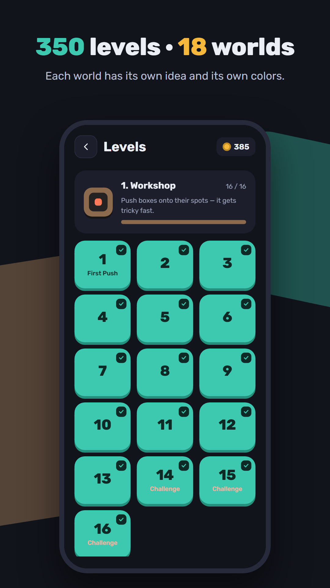
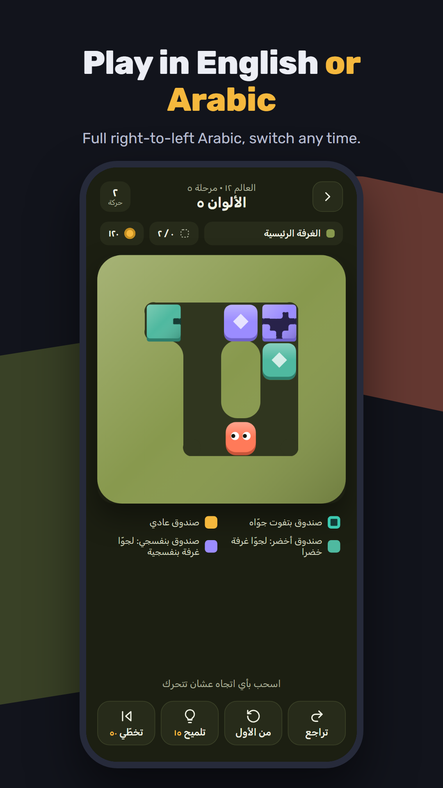

<p align="center">
  
</p>

<h1 align="center">Cubes Paradox</h1>

<p align="center">
  A puzzle game about boxes that hold whole rooms.<br>
  Push boxes, walk inside them, and find your way back out.<br>
  <b>350 levels · 18 worlds · English &amp; Arabic · fully offline</b>
</p>

<p align="center">
  <a href="https://rookieenough.github.io/Orion-Data/app/?id=cubes-paradox"></a>
  &nbsp;
  <a href="https://github.com/DAOUDsys/cubes-paradox/releases/latest"><b>or download the APK</b></a>
</p>

## Screenshots

<p align="center">
  
  
  
  
</p>
<p align="center">
  
  
  
</p>

## The game

Every colored box is a complete room. Push it like any box — or, when it can't move, walk right into it. Inside, the room is just as real: push boxes around, walk out through a gap in the wall, and you're back where you were. Boxes can go into rooms, rooms can go into rooms, and a few rooms even contain themselves.

The 18 worlds each focus on one idea, then start combining them:

| # | World | Idea |
|---|---|---|
| 1 | Workshop | Push boxes onto their spots |
| 2 | Greenhouse | Walk into boxes and through them |
| 3 | Warehouse | Push boxes into rooms and back out |
| 4 | The Well | Rooms inside rooms |
| 5 | Mirror Hall | A room that holds itself |
| 6 | Ice Cave | Ice: things slide until they hit something |
| 7 | Power Station | Plates and gates: hold every plate to open the gates |
| 8 | Factory | One-way arrow tiles |
| 9–18 | Frozen Lake → The Paradox | The ideas above, mixed together and harder |

The last three levels of each world are optional challenges. Solving levels earns points; points buy hints (your next 8 moves) or skips.

## Features

- 350 levels, each checked by a solver — every one can be solved
- Hints that work from wherever you are, not just from the start
- Unlimited undo and instant restart
- Swipe controls, plus arrow keys / WASD in a browser
- English and Arabic with full right-to-left layout
- No ads, no accounts, no data collected — progress stays on the device

## Run it

In a browser:

```
npm run serve
```

Then open http://localhost:8080 (arrows or WASD to move, Z undo, R restart, H hint).

Build the Android APK (needs Node, the Android SDK and Java 21):

```
npm install
npm run apk
```

The APK is written to `android/app/build/outputs/apk/debug/app-debug.apk`.

## Levels

Levels are generated, solved and picked by scripts in `tools/`:

- `npm run gen` — generates candidate levels for 5 minutes into `tools/out/`
- `npm run curate` — picks the 350 levels by world and difficulty and writes `www/js/levels.js`
- `npm run solve` — checks that every level can be won and that its stored solution (used by hints) works

## Project layout

| Path | What |
|---|---|
| `www/js/engine.js` | Game rules (no DOM), also used by the solver in Node |
| `www/js/render.js` | Canvas renderer, draws rooms inside rooms recursively |
| `www/js/app.js` | Screens, input, animation, progress, hints |
| `www/js/i18n.js` | English and Arabic text, world names |
| `www/js/levels.js` | The 350 levels |
| `tools/` | Level generator, picker and solver |
| `store/` | Store listing text, icon, banner and screenshots |
| `android/` | Capacitor Android project |

Built with plain JavaScript and [Capacitor](https://capacitorjs.com).
